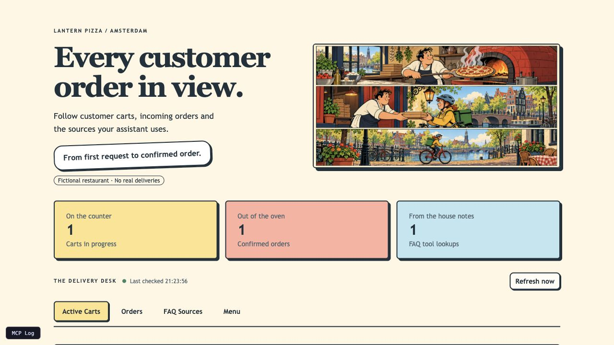
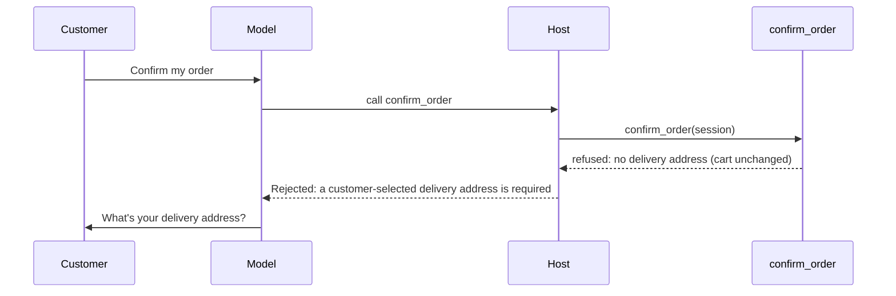

# Agent observability 101 — Chapter 1

Build a local assistant and see what it actually did through three Python-friendly
tools: **Prefab** for a small operator UI, **MCP with FastMCP middleware** for
business actions and source evidence, and **rapid-mlx** for local inference and
measurements.

Lantern Pizza is a fictional Amsterdam pizzeria. You build a local AI assistant
with MCP business tools and a Prefab delivery desk for the person running the
restaurant. Follow customers' carts as they change, see confirmed and cancelled
orders, and inspect the FAQ sources the assistant consults.

The delivery desk reads the same business state as the agent's tools. You choose
what to display, so you can compare the assistant's replies with the resulting
carts and orders and reuse the pattern for your own application.



For Python developers and data scientists who know functions, dictionaries and
basic HTTP. No prior MCP, Prefab or MLX experience is needed. Follow one customer's
order through three arcs:

1. **Prefab basics:** compose a view in Python and refresh it from the same records
   your tools change. Reuse the pattern for your own operational view.
2. **MCP and middleware:** expose Python functions as discoverable tools and
   observe FAQ lookups once, around execution, without adding logging to every tool.
3. **rapid-mlx metrics:** inspect context tokens, client TTFT, request throughput
   and server-wide memory and rates, then see how one model boundary lets you
   swap endpoints. Each measurement's scope stays explicit.

A fluent reply does not prove an action happened. Compare the assistant's words,
the tool results and the resulting cart or order. Chapter 1 supplies this working
foundation; conversation tracing and evaluations follow in later chapters.
Read the [article](article.md) for the three arcs, or use the
[25-minute presentation guide](PRESENTING.md) for a demo-led walkthrough.

## Start the assistant and delivery desk

Install [uv](https://docs.astral.sh/uv/), Git and Make. This chapter uses **uv
0.13.1** and **Python 3.14.4**, selected by [.python-version](.python-version);
uv installs that Python if needed. The package's supported minimum is Python 3.11.
CI uses the same pinned uv and Python versions.

```bash
git clone https://github.com/adityakunar/agent-observability-101.git
cd agent-observability-101
```

On an Apple silicon Mac, install [rapid-mlx](https://github.com/raullenchai/Rapid-MLX#installation)
as a separate tool, then start the chapter:

```bash
uv tool install rapid-mlx==0.16.8
make up
make chat
```

The library baseline is **Prefab (`prefab-ui`) 0.20.2**, **FastMCP 4.1.2** and
**rapid-mlx 0.16.8**. Application, development and build dependencies have exact
versions in [pyproject.toml](pyproject.toml); [uv.lock](uv.lock) also fixes transitive
application dependencies and their artifact hashes. Make commands use `--locked`
so dependency edits require an intentional lockfile refresh. Rapid-mlx is a
separate tool environment: its top-level version is pinned here, while its own
transitive dependencies are resolved by `uv tool install`.

Managed model launches check the installed rapid-mlx version and refuse a
mismatch. An already-running endpoint is reused; check its version and model
yourself when rehearsing, or restart the services this checkout manages.

`make up` installs the locked application dependencies and starts Gemma 4 E4B on port
9000 and MCP with the delivery desk on 8000. The first model start downloads
weights and can take longer than the default 60-second wait. If that happens,
inspect `make logs`, then retry `make up STARTUP_TIMEOUT=300`.
The [4-bit Gemma weights](https://huggingface.co/mlx-community/gemma-4-e4b-it-4bit)
download is about 5.2 GB; inference also needs memory for context and running apps.
The serving alias fixes the model choice and quantization, but does not pin a Hub
revision. Record the weight revision as well as software versions for performance
comparisons; a software pin alone does not freeze model artifacts.
If rapid-mlx reports memory pressure, stop the managed model with `make down`
and retry `make up MLX_ARGS='--gpu-memory-utilization 0.5'`, or use a smaller
compatible model.

Open the delivery desk at <http://localhost:8000>. Play the customer in
the terminal chat and follow their order in your delivery desk. Chat replies
stream as they arrive. Use `/quit` to leave chat and `make down`
to stop services started by this checkout. Existing services are reused.
Once installed, everything runs offline: inference, address lookup and the desk,
which is a self-contained page served by the MCP server.

Each completed model request prints a compact `llm>` measurement line: context
(prompt tokens sent, which grows every turn), client TTFT (first streamed output), elapsed time, reported output tokens per second
over the whole request, and MLX peak memory when a local rapid-mlx server exposes
it. Missing measurements show `n/a`. This is per model call, so tool execution
and waiting for the customer are excluded. See [what the numbers mean](article.md#watch-the-local-model-work).

### Linux or another model endpoint

Start an OpenAI-compatible local model that supports tool calls. For example,
with [Ollama](https://docs.ollama.com/api/openai-compatibility) installed and running:

```bash
ollama pull qwen3:8b
export AGENT_OBSERVABILITY_LLM_BASE_URL=http://localhost:11434/v1
export AGENT_OBSERVABILITY_LLM_MODEL=qwen3:8b
make up LLM=external
make chat
```

The same settings work with a compatible LM Studio or vLLM endpoint that needs
no API key. `LLM=external` leaves model startup and shutdown to you. Settings can
also go in `.env.local`; it overrides `.env`, and both are ignored by Git.
Endpoint wiring is tested offline; this Ollama/Linux conversation recipe has
not been verified live here. Gemma 4 E4B on Apple silicon is the primary recipe.

### Swap the model, keep the agent

The host depends on one `Model.complete(...)` method. `APIModel` implements it
with an OpenAI-compatible API call, whether the model runs locally or on a
provider's server. Set the endpoint, model name and, when needed, API key in
`.env.local`:

```dotenv
AGENT_OBSERVABILITY_LLM_BASE_URL=https://your-provider.example/v1
AGENT_OBSERVABILITY_LLM_MODEL=your-tool-calling-model
AGENT_OBSERVABILITY_LLM_API_KEY=your-provider-key
AGENT_OBSERVABILITY_LLM_API_KEY_EXPIRES=2027-01-31
AGENT_OBSERVABILITY_ALLOWED_HOSTS=your-provider.example
```

The app only sends the key to a loopback model or to an HTTPS host listed in
`AGENT_OBSERVABILITY_ALLOWED_HOSTS`.

On macOS, keep the key out of files entirely: `make key-set EXPIRES=2027-01-31`
stores it in the Keychain, and the app reads it from there when it starts. Every key
needs an expiry date. The app refuses to start once it has passed, and
`make rotate-key` replaces the key without downtime. [SECURITY.md](SECURITY.md)
explains why, and what to lock down before you give an agent a shell.
`make agent-container` runs the agent in a container whose only network exit is an
allowlisting proxy that adds the key, so the agent never sees it.

Then use `make up LLM=external` and `make chat`. Use your provider's actual
endpoint and model identifier; this block is a configuration shape. A hosted
endpoint receives the conversation and tool results and may charge for calls.
The [adapter lesson](article.md#swap-the-model-at-one-boundary) explains the
contract and how to adapt an API with a different wire format. Tool dispatch
and business rules stay in this application.
It also links to [LiteLLM's completion interface](https://docs.litellm.ai/docs/completion)
for projects that need broader provider support through an adapter.

To change a model managed by `make up`, stop it first, set
`AGENT_OBSERVABILITY_LLM_MODEL` to the new alias, then run
`make up LLM_MODEL=the-same-alias`. This keeps the serving process and the API
request in agreement. `make up` otherwise reuses an existing server on port 9000.

### If startup fails

Run `make status` to check both ports and `make logs` to inspect `.run/`
logs. `make server` runs MCP and the delivery desk in the foreground. Stop the
process occupying a required port before retrying. After code
changes, restart managed services with `make down` followed by `make up`.

## Follow a customer's changing order

Send these customer requests in the chat. Start with the pizzas, then add the
rest in a second message:

> Two large Meat Lovers on thin crust, please.

> Add garlic bread and a Coke, then apply the meal deal if it qualifies.

Then change the order, one request per message:

> Make that one pizza.

> Drop the garlic bread.

Watch the customer's cart change and see whether it still qualifies for the deal.
Each pizza shows its size, crust, quantity and price. Try another pizza, change
a quantity, or ask to empty the cart and start over.

## Examine the agent's behavior

> Does the garlic bread contain milk? Where does it say that?

Follow the lookup in **FAQ Sources** and choose **Open source** to read the
original document, including its table headings. **Menu** shows the options and
prices available to the customer. Your Prefab UI brings these records together,
so you can check the assistant's answer against its sources and see what changed
in the cart.

The FAQ is a small [Markdown corpus](knowledge_base/). Four tools let the agent
list documents, find filenames, search text and read the original source for
context. The [corpus-access lesson](article.md#retrieve-context-directly-from-a-markdown-corpus)
explains how this retrieval works and why a matching line sometimes needs the
surrounding table or notes.

## See orders come in

Try confirming before giving an address. The assistant may ask for the missing
details. If it calls the order tool anyway, the tool refuses, your cart stays as it
was, and the refusal goes back to the model as the tool's result:



The rule lives in the tool, so no wording from the model can place the order.
Then recover:

As the customer, give the assistant `Damrk 1, Amsterdam` and choose a suggested
delivery address. Review the order and delivery quote, then confirm. In your
delivery desk, the confirmed order appears in **Orders**.

Changed your mind again?

> Show my orders. Cancel the one I just placed.

The cancelled order stays in view. Nothing is charged or delivered—this is a demo.
State lives in memory and resets when the server restarts.

For the code walkthrough, read the [chapter-one article](article.md).
Settings are in [.env.example](.env.example); run `make verify` to check the code.

## Small enough to follow

```text
src/agent_observability/
├── chat.py              the terminal chat: wires the model, MCP client and display
├── model.py             one model request (APIModel)
├── client.py            the host interface: Agent.prepare and Agent.send
├── host/
│   ├── loop.py          the bounded model → tools → model loop
│   ├── steps.py         runs requested tools, with budgets and duplicate suppression
│   └── dispatch.py      adds the session ID; hands address choice to the customer
├── llm/                 the Model contract, streaming and per-request metrics
├── pizza/
│   ├── domain.py        the records: carts, orders, addresses
│   ├── state.py         carts and orders, in memory
│   ├── tools/           business actions: menu, items, deals, cart, delivery, orders
│   ├── server.py        composes the tools and serves the delivery desk
│   └── operator/        the Prefab delivery desk (app.py, routes.py and one file per tab)
├── faq/                 read-only Markdown FAQ tools, plus the lookup observer
└── utilities/addresses/ offline address lookup over a bundled Amsterdam snapshot
```

Start with `chat.py` and follow the calls. All 18 tool definitions are available
from the first model request; menu data and FAQ text enter the conversation only
through tool results. The [MCP lesson](article.md#what-the-model-sees-and-when)
explains this difference between discovering tools and retrieving their content.

Addresses come from a snapshot in [resources/addresses/](resources/addresses/), so
nothing is downloaded at startup; its README explains how to rebuild it. Artwork,
menu records and screenshots live in [resources/](resources/) too. Every
production Python module is under 100 lines.

The offline tests exercise real MCP tools with scripted model replies. They
check business rules and host control; they do not measure model reliability.
Customer approval, requested choices and accurate answer wording still depend on model behavior,
as the article explains. This chapter installs no application trace exporter,
evaluation system or conversation archive.

## What comes next

Chapter 2 will record the requests, results and state changes behind this same
conversation. Chapter 3 will check the expected business sequence; Chapter 4
will assess the assistant's words against the evidence. Later chapters will
save those conversations and extend the custom UI for debugging traces and
adding human annotations.

The [chapter roadmap and maintainer handoff](ROADMAP.md) records the release
checks, implementation boundaries and open decisions for subsequent chapters.
Chapter 2 is the next implementation step; later chapters build on the same
customer journey and preserve each released chapter with its own Git tag.

[MIT licence](LICENSE). [Address data and licence](resources/addresses/README.md).
