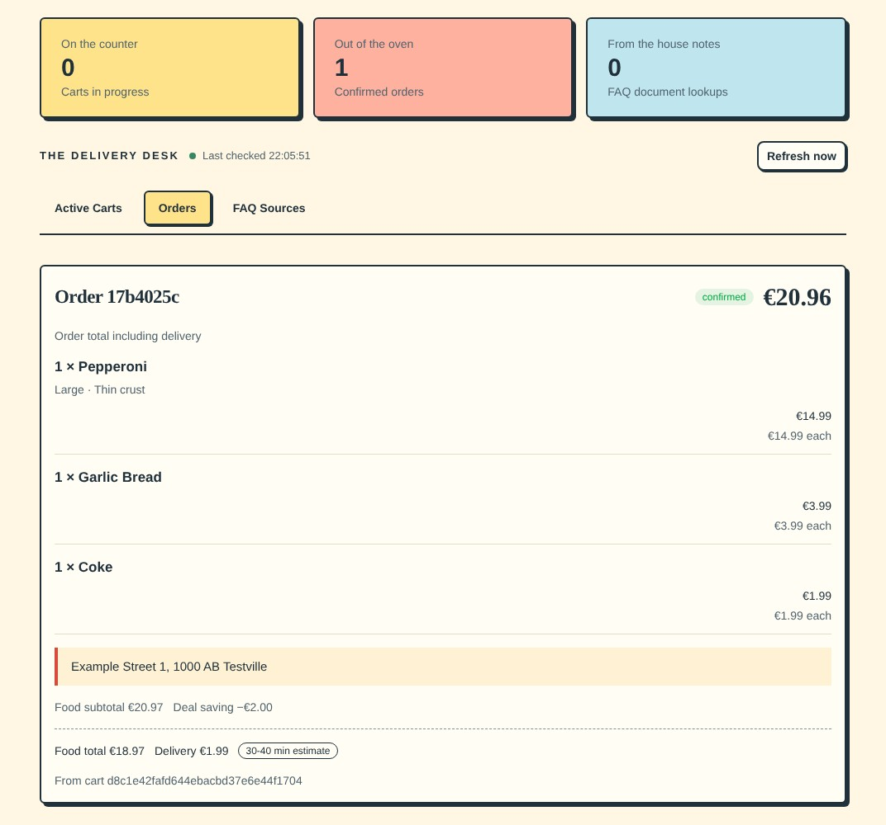
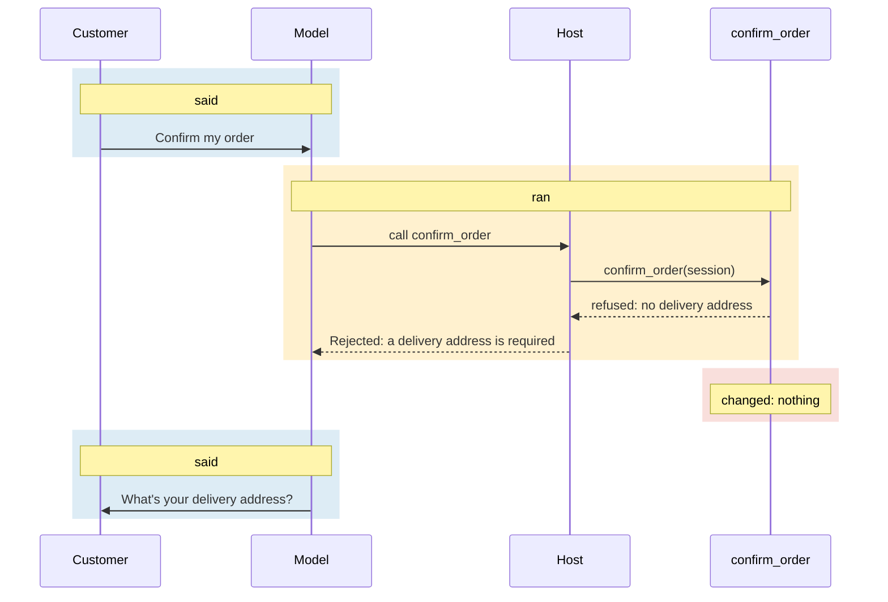

# Agent observability 101

The assistant says the order is placed. Did it happen?


A fluent reply does not prove an action. This chapter builds a small local AI
assistant and shows you three things apart: what the assistant **said**, which
tools the host **ran**, and which business records **changed**.

Lantern Pizza is a fictional Amsterdam pizzeria. A customer orders in a terminal
chat. You follow the carts and the orders on a browser page, the delivery desk,
which reads the same records that the tools change.



What you take away:

- **One idea:** compare what was said, what was done and what changed.
- **One file to copy:** [client.py](src/agent_observability/client.py), the loop
  between the model and the tools.
- **One test with no model:** [tests/test_sushi_pizza.py](tests/test_sushi_pizza.py).
- **One list:** [Use this in your project](article.md#use-this-in-your-project).

The [article](article.md) is Chapter 1. [Chapter 2](chapter-2.md) records each
step of a chat and finds the one where a false answer went wrong. This page
gets you started. It is for
Python developers and data scientists who know functions, dictionaries and basic
HTTP.

| Word | Meaning here |
|---|---|
| **model** | the language model, local or hosted; it proposes text and tool calls |
| **host** | the small Python loop that talks to the model and runs the tools |
| **assistant** | what the customer talks to: the model plus the host |
| **MCP** | Model Context Protocol, a standard way for a program to find and call tools |
| **FastMCP** | the Python library that serves our tools over MCP |
| **Prefab** | a Python library that builds browser pages; it draws the delivery desk |
| **rapid-mlx** | a local model server for Apple silicon Macs, built on Apple's MLX framework |
| **TTFT** | time to first token: the time until the first output of the model arrives |

When you use a hosted model, the API key stays in the macOS Keychain with an
expiry date and goes only to hosts that you allow. The server answers only local
requests. [SECURITY.md](SECURITY.md) gives each step.

## Start the assistant and delivery desk

Install [uv](https://docs.astral.sh/uv/), Git and Make, then clone the repository:

```bash
git clone https://github.com/adityakunar/agent-observability-101.git
cd agent-observability-101
```

On an Apple silicon Mac, install [rapid-mlx](https://github.com/raullenchai/Rapid-MLX#installation)
as a separate tool:

```bash
uv tool install rapid-mlx==1.1.0
```

Then start the chapter. `make up` starts the model and the server in the
background and waits until both answer, so the chat cannot start too early:

```bash
make up        # start both and wait; the first start downloads the model
make status    # the model that the chat will use, and what answers on each port
make chat
make down      # stop what make up started
```

To watch each part work, give each one a terminal instead:

```bash
make model     # terminal 1: the local model, port 9000
make server    # terminal 2: the MCP tools and the delivery desk, port 8000
make chat      # terminal 3: the chat
```

Each part stays in its terminal and shows its own output. Here nothing waits for
you: start `make chat` only when the model in terminal 1 and the server in
terminal 2 have started. On the first run that takes a while, and a chat that
starts too early reports that it cannot reach them. Press Ctrl+C in a terminal to
stop that part.

Versions are pinned: **Prefab (`prefab-ui`) 0.21.1**, **FastMCP 4.1.4**,
**rapid-mlx 1.1.0**, **uv 0.13.6** and **Python 3.14.4** (selected by
[.python-version](.python-version); uv installs it if needed, and the package
accepts Python 3.11 or newer). [uv.lock](uv.lock) fixes the rest, including
artifact hashes, and Make commands use `--locked`, so a dependency edit needs a
deliberate lockfile refresh. CI uses the same pins.

> **NOTE** rapid-mlx is a separate tool environment. Its version is pinned in the
> Makefile and `make model` refuses a different one; its own dependencies are
> resolved by `uv tool install`.

`make model` starts rapid-mlx with its telemetry, version check and chat web tools
switched off. For more protection, run the model server as a second macOS user and
keep your own files out of its reach: see [SECURITY.md, section 3.6](SECURITY.md#36-tidbit-a-second-user-is-the-cheapest-sandbox).
The chat uses the server that listens on port 9000. If you did not start that server
with `make model`, check its version and model yourself.

**First start.** `make model` starts Gemma 4 E4B (alias `gemma-4-e4b-4bit`) on
port 9000. The first start downloads about 5.2 GB of
[4-bit Gemma weights](https://huggingface.co/mlx-community/gemma-4-e4b-it-4bit)
and can take many minutes. Terminal 1 shows what the model server does. The first
`make server` installs the locked dependencies, then serves MCP and the delivery
desk on port 8000. The alias fixes the model and its
quantization but not a Hub revision: record the weight revision next to the
software versions when you compare performance.

**If memory is short.** Inference needs memory for the context and for your other
apps. If rapid-mlx reports memory pressure, stop the model with Ctrl+C and retry
with `make model MLX_ARGS='--gpu-memory-utilization 0.5'`, or use a smaller
compatible model.

Open the delivery desk at <http://localhost:8000>. Play the customer in
the terminal chat and follow their order in your delivery desk. Chat replies
stream as they arrive. Use `/quit` to leave the chat. Stop the rest with
`make down`, or with Ctrl+C in each terminal if you started the parts yourself.
Once installed, everything runs offline: inference, the tools and the desk,
which is a self-contained page served by the MCP server.

Each completed model request prints one `llm>` line: **context** (prompt tokens
sent; it grows every turn), **TTFT** (time to first token, measured at the client),
**total** request time, output **tokens per second** over the whole request, and
**MLX peak** memory when a local rapid-mlx server reports it (for the whole server,
not this conversation). Missing values show `n/a`. The line covers one model call:
tool execution and waiting for the customer are not included. See
[what the numbers mean](article.md#3-measure-one-line-for-each-model-request).

### Linux or another model endpoint

Start an OpenAI-compatible local model that supports tool calls. For example,
with [Ollama](https://docs.ollama.com/api/openai-compatibility) installed and running:

```bash
ollama pull qwen3:8b
```

Point the `local` profile at it. Create `models.local.toml` next to `models.toml`:

```toml
[local]
base_url = "http://localhost:11434/v1"
model = "qwen3:8b"
```

Then run `make server` in one terminal and `make chat` in a second. You do not
need `make model`: you start and stop your model yourself. `make status` shows
the model that the chat will use.

The same profile works with a compatible LM Studio or vLLM endpoint that needs
no API key. Git ignores `models.local.toml`.
This Ollama/Linux recipe has not been verified live here. Gemma 4 E4B on Apple
silicon is the primary recipe.

### Swap the model, keep the agent

The host depends on one `Model.complete(...)` method. `APIModel` implements it
with an OpenAI-compatible API call, whether the model runs locally or on a
provider's server. One switch selects the model: a profile. Add a profile to
`models.local.toml`:

```toml
[provider]
base_url = "https://your-provider.example/v1"
model = "your-tool-calling-model"
```

Put the key, when the provider needs one, in `.env.local`:

```dotenv
AGENT_OBSERVABILITY_LLM_API_KEY=your-provider-key
AGENT_OBSERVABILITY_LLM_API_KEY_EXPIRES=2027-01-31
```

The app only sends the key to a loopback model or to an allowed HTTPS host. A
profile allows its own host for that run.

On macOS, keep the key out of files entirely: `make key-set EXPIRES=2027-01-31`
stores it in the Keychain, and the app reads it from there when it starts. Every key
needs an expiry date. The app refuses to start once it has passed, and
`make rotate-key` replaces the key without downtime. [SECURITY.md](SECURITY.md)
explains why, and what to lock down before you give an agent a shell.

Then run `make server PROFILE=provider` and `make chat PROFILE=provider`, each in
its own terminal. A hosted model needs no `make model`. Without `PROFILE`, both
use the local model: a hosted model never runs unless you name it. Use your provider's actual
endpoint and model identifier; the block above shows the shape, not real values. A hosted
endpoint receives the conversation and tool results and may charge for calls.
The article shows [the one method](article.md#change-the-model-in-one-place)
that a model must have, so you can write a class for an API with a different
format. The tools and the business rules do not change with the model.

To change the local model, stop `make model` first, set `model` under `[local]`
in `models.local.toml` to the new alias, then run
`make model LLM_MODEL=the-same-alias`. This keeps the serving process and the API
request in agreement.

### If startup fails

Each terminal shows the errors of its own part. If an error says that port 9000 or
port 8000 is in use, find the process with `lsof -nP -iTCP:8000 -sTCP:LISTEN`, stop
it, then retry. After code changes, stop `make server` with Ctrl+C and start it again.

## Follow a customer's order

Open the delivery desk at <http://localhost:8000>. Type these messages in the
chat, one at a time, and look at the delivery desk after each one:

> A large pepperoni on thin crust, garlic bread and a Coke. Apply the meal deal.

> Remove the garlic bread.

The discount goes with the garlic bread: a deal stays only while the cart has
the items that the deal needs.

> Add the garlic bread again and apply the deal.

> Confirm my order.

There is no address, so no order is placed and the cart does not change. Often
the model asks for the address at once. If it calls the order tool first, the
tool refuses, and the refusal goes back to the model as the result of the tool:



The rule is in the tool, so no wording from the model can place the order. Give
an address, for example `Damrak 1, 1012 LG Amsterdam`. The tool saves your words
as they are; it does not check that the address exists. Approve the order. The
confirmed order appears in **Orders**, and the total is €20.96. If the assistant
places the order before you approve, you have found a fault that we left in:
see [What is still broken](article.md#what-is-still-broken).

Then ask a question that needs a source:

> Does the garlic bread contain milk? Where does it say that?

**FAQ Sources** shows which document the assistant read. Select **Open source**
and compare the document with the answer. The FAQ documents are four Markdown
files in [knowledge_base/](knowledge_base/).

### Then see a false claim

Leave the chat with `/quit`, start a new one with `make chat`, and type:

> Hi, I'll take a personal BBQ Chicken with thin crust

> I'm allergic to celery. Is there celery in the BBQ sauce? If so, swap it for a personal Margherita, thin crust.

Read the reply, then look at the `tool>` lines and at the cart on the delivery
desk. Often the assistant said that it removed the BBQ Chicken,
the only tool that ran was `faq_read`, and the cart did not change. If your
chat makes the swap, start a new chat and try again. This is the fault that the
[article](article.md) starts with.

### Then find the step

Each chat writes a record to `.run/records/`. Read the newest one:

```bash
make inspect VERB=show   # each step: what the model asked, what the host did, what changed
make inspect             # only the steps where two of these disagree
```

`make inspect` needs the model: it sends each recorded request again to check
that the record holds what the model received. [Chapter 2](chapter-2.md)
explains the output. A record holds the full conversation, so Git ignores the
folder.

Nothing is charged or delivered: this is a demo. The records are in memory and
are gone when the server stops. A real model can take a different path from the
one above. That is why you look at the records.

Settings are in [.env.example](.env.example). Run `make verify` to check the code.

## Small enough to follow

```text
src/agent_observability/
├── chat.py              the terminal chat: wires the model, MCP client and display
├── model.py             one model request (APIModel)
├── client.py            the host: the bounded model → tools → model loop (Agent)
├── record.py            the record of a chat: three layers for each step (Chapter 2)
├── inspector.py         reads a record and finds the step where layers disagree
├── llm/                 the Model contract, the stream reader and the metrics of a request
├── pizza/
│   ├── domain.py        the records: menu items, carts, orders
│   ├── state.py         carts and orders, in memory
│   ├── tools/           business actions: menu, items, deals, cart, delivery, orders
│   ├── server.py        composes the tools and serves the delivery desk
│   └── operator/        the Prefab delivery desk (app.py, routes.py and one file per tab)
├── faq/                 the tool that reads an FAQ document, and the observer of its calls
└── utilities/           finds the bundled resources from any directory
```

Start with `chat.py` and follow the calls. The model gets the definitions of
all nine tools with each request. Menu data and FAQ text enter the conversation
only through tool results.

The menu records, the desk styling and the screenshot are in [resources/](resources/).

The offline tests use the real MCP tools and a model that answers from a script.
They check the business rules and the rules of the host. They do not measure how
reliable a model is. The repository has no trace export and no evaluation, and
it saves a conversation only in the local record of its chat.

## What comes next

The plan for Chapter 3 is to turn the steps of a record into business events.
Later chapters check the events with code, and use a second model as a judge
for what the assistant said.

Each released chapter keeps its own Git tag.

[MIT licence](LICENSE).
