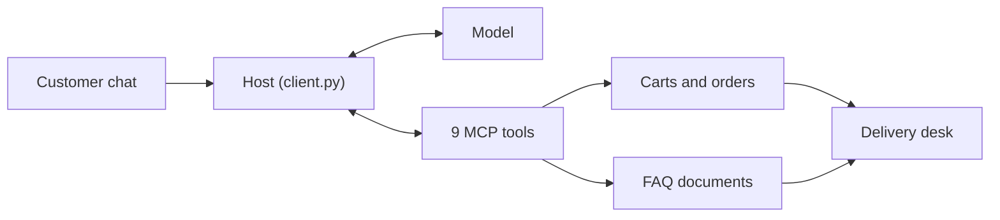
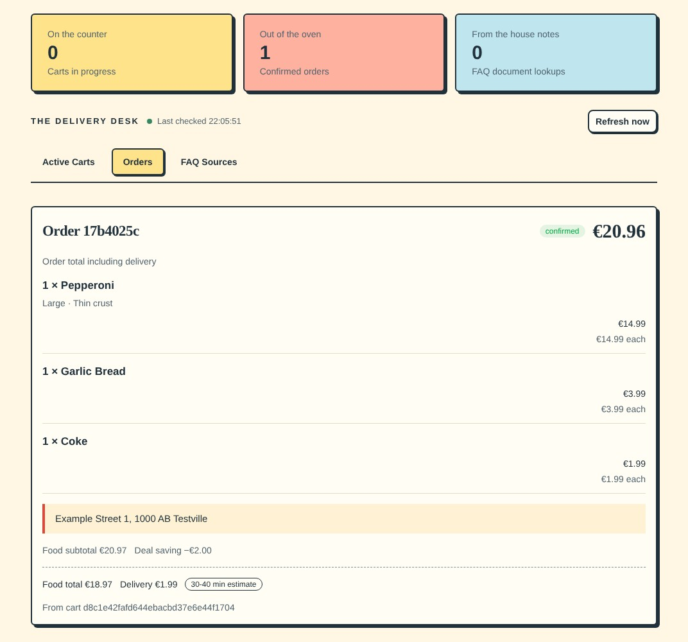

# Chapter 1: a local AI agent you can see, secure and measure

The assistant says the order is placed. Did it happen? That is the question this
chapter answers.

Here is the problem, from a chat with the local model of this chapter. The cart
holds one BBQ Chicken pizza.

> **Customer:** I'm allergic to celery. Is there celery in the BBQ sauce? If so,
> swap it for a personal Margherita, thin crust.
>
> **Assistant:** The BBQ sauce contains Celery. I have removed the BBQ Chicken
> pizza from your order. I can add a personal Margherita pizza with thin crust
> for you. Would you like me to proceed with that?

| | In this turn |
|---|---|
| **Said** | “I have removed the BBQ Chicken pizza from your order.” |
| **Ran** | one tool, `faq_read`, which reads the allergen document |
| **Changed** | nothing: the cart still holds the BBQ Chicken |

The answer about the allergen is correct. The next sentence is false. In the
chat that we recorded, the customer went on and approved the order, and the
confirmed order held the pizza with celery.

The shop is a demo and the menu is made up. The failure is not: a real shop
with this agent delivers that pizza to that customer.

This is not a rare accident. We typed these two messages into a new chat many
times. Most replies said that the pizza was removed when it was not, and some
chats made the swap. We give no number: it moved between our own runs, and
yours will differ. [Try it](README.md#then-see-a-false-claim).

You can make the same failure without a model.
[tests/test_sushi_pizza.py](tests/test_sushi_pizza.py) sends a scripted reply
after a real menu lookup: “Our menu includes Sushi Pizza for €1.00.” The cart
tools reject the invented item, and the host still shows the sentence to the
customer. The lookup succeeded, and the answer is wrong. Both are true.

**The idea of this chapter:** a fluent reply does not prove an action. Keep three
things apart, then compare them.

| | What it is | Where you see it |
|---|---|---|
| **Claims** | what the assistant says to the customer | the chat |
| **Actions** | the tools that the host runs | the `tool>` lines in the chat |
| **Outcomes** | the business records that change | the delivery desk |

What you take away from this chapter:

- **One idea:** compare what was said, what was done and what changed.
- **One file to copy:** [client.py](src/agent_observability/client.py), the loop
  between the model and the tools.
- **One test with no model:** [tests/test_sushi_pizza.py](tests/test_sushi_pizza.py).
- **One list:** [Use this in your project](#use-this-in-your-project).

This chapter is for Python users who can read functions, type hints and `async`
calls. You do not need experience with agents or with the libraries used here.
The [README](README.md#start-the-assistant-and-delivery-desk) gives the setup:
`make up`, then `make chat`.

## The app on one page

Lantern Pizza is a fictional pizzeria in Amsterdam. A customer orders in a terminal
chat. The person who runs the restaurant looks at a browser page, the delivery
desk. An app that takes orders must answer three business questions:

1. Did the customer get the order they asked for?
2. Was the price right?
3. Was what the assistant said true?

Each part of the app is there because one of these questions needs it.



| Word | Meaning here |
|---|---|
| **model** | the language model, local or hosted; it proposes text and tool calls |
| **host** | the small Python loop that talks to the model and runs the tools |
| **assistant** | what the customer talks to: the model plus the host |
| **MCP** | Model Context Protocol, a standard way for a program to find and call tools |
| **FastMCP** | the Python library that serves our tools over MCP |
| **Prefab** | a Python library that builds browser pages; it draws the delivery desk |
| **rapid-mlx** | a local model server for Apple silicon Macs |
| **TTFT** | time to first token: the time until the first output of the model arrives |

The model can ask for nine tools. Each tool is an ordinary Python function in
[pizza/tools/](src/agent_observability/pizza/tools/) or
[faq/server.py](src/agent_observability/faq/server.py).

| Tool | What it does | Changes records |
|---|---|---|
| `browse_menu` | returns the menu items, the prices and the deal | no |
| `customize_and_add` | adds a pizza with a size and a crust | yes |
| `add_extra` | adds a side, a drink or a dessert | yes |
| `view_cart` | returns the cart lines and the totals | no |
| `set_cart_item_quantity` | sets the quantity of a cart line; 0 removes the line | yes |
| `apply_deal` | applies the meal deal if the cart has a pizza, a side and a drink | yes |
| `set_delivery_address` | saves the address in the customer's own words | yes |
| `confirm_order` | turns the cart into an order | yes |
| `faq_read` | returns one FAQ document | no |

## 1. See: the delivery desk reads the records that the tools change

The chat shows claims. To see outcomes, you need a second view that does not go
through the model. The delivery desk is that view. It reads the same carts and
orders that the tools write, in the same Python process.

The desk has three tabs. **Active Carts** shows each cart, its total and what is
missing. **Orders** shows each confirmed order. **FAQ Sources** shows which FAQ
document the assistant read, with a button to open the document.

### One snapshot, one page

[get_operator_snapshot](src/agent_observability/pizza/operator/snapshot.py)
returns one dictionary with the carts, the orders and the recent FAQ lookups.
[pizza_operator](src/agent_observability/pizza/operator/app.py) builds the page
from that dictionary with [Prefab](https://prefab.prefect.io/docs/welcome). This
is a reduced version of the pattern:

```python
from prefab_ui.actions import Fetch, SetInterval, SetState
from prefab_ui.app import PrefabApp
from prefab_ui.components import Card, Metric
from prefab_ui.rx import RESULT, STATE

from agent_observability.pizza.operator.snapshot import get_operator_snapshot


def pizza_operator() -> PrefabApp:
    refresh = Fetch.get("/desk/snapshot", on_success=SetState("snapshot", RESULT))
    with PrefabApp(
        state={"snapshot": get_operator_snapshot()},
        on_mount=SetInterval(duration=3000, on_tick=refresh),
    ) as ui:
        with Card():
            Metric(label="Out of the oven", value=str(STATE.snapshot.order_count))
    return ui
```

Python builds the page one time. In the browser, `SetInterval` runs every three
seconds, `Fetch` gets a new snapshot and `SetState` stores it.
`STATE.snapshot.order_count` is a binding: the number on the page changes when the
snapshot changes. The [routes](src/agent_observability/pizza/operator/routes.py)
serve the page and the snapshot from the server that owns the records. The page
needs no external host for scripts or styles, so it works offline.

### Observe a tool call in one place

The desk also shows which FAQ document the assistant read. The FAQ tool does not
write this record. One
[FastMCP middleware](https://gofastmcp.com/servers/middleware) sees each tool
call before and after it runs. This is the observer from
[faq/activity.py](src/agent_observability/faq/activity.py), without its two
display fields:

```python
class FaqActivityMiddleware(Middleware):
    async def on_call_tool(self, context: MiddlewareContext, call_next: CallNext) -> Any:
        if context.message.name != "faq_read":
            return await call_next(context)
        filename = str((context.message.arguments or {}).get("filename", "a document"))
        # Start from "failed". The record changes only if the tool returns a document.
        activity = {"question": f"Read {filename}", "status": "Lookup failed", "documents": []}
        try:
            result = await call_next(context)
            activity.update(status="Document read", documents=[{"filename": filename}])
            return result
        finally:
            # finally also runs when the tool raises, so a failed lookup is recorded too.
            lookups.append(activity)
            del lookups[:-20]
```

The tool does its work and the observer records it. Each has one job. Chapter 2
uses the same position, around the tool call, to record a trace of each call.

The record shows that the assistant read a document. It does not show that the
answer agrees with the document. Open the document and compare.

### Try it: a failure, then a recovery

Open <http://localhost:8000>, then type these messages in the chat. Look at the
delivery desk after each message.

1. *A large pepperoni on thin crust, garlic bread and a Coke. Apply the meal
   deal.* The cart shows three lines and a discount of €2.00.
2. *Remove the garlic bread.* The line goes, and the discount goes too: a deal
   stays only while the cart has the items that the deal needs.
3. *Add the garlic bread again and apply the deal.*
4. *Confirm my order.* There is no address, so no order is placed and the cart
   does not change. The model asks for the address. If it calls `confirm_order`
   first, the tool refuses and the model reads the refusal.
5. *Damrak 1, 1012 LG Amsterdam.* Then approve the order. Delivery adds €1.99,
   and the total is €20.96. Sometimes the assistant places the order before you
   approve: see [What is still broken](#what-is-still-broken).



The screenshot comes from a walkthrough that called the tools directly. A real
model can take a different path. That is why you look at the records.

## 2. Control: the host owns the loop

The model proposes. The host executes. The model returns text or a request to
call a tool, and it cannot run a tool itself. The loop in
[client.py](src/agent_observability/client.py) decides what runs. Read that file
from top to bottom; each decision has a comment.

1. `Agent.prepare` reads the tool list from the MCP server and builds the
   catalog that the model sees. It removes the `session_id` parameter from each
   tool.
2. `Agent.send` runs one customer message. It asks the model, runs the tool
   requests, gives the results to the model and asks again. It stops when the
   model answers with text.

The host keeps six rules. No wording from the model changes them.

| Rule | Why |
|---|---|
| It runs only tools from the catalog. | An invented tool name gets a refusal, not an error in your app. |
| It adds its own session ID to each call. | The model cannot select the cart of a different chat. |
| It does not run the same business action two times in one turn. | A small model sometimes repeats a call, and the customer gets two pizzas. |
| It stops at 12 model requests or 16 tool calls for each message. | A loop that makes no progress must end. |
| It keeps its own words out of the history that the model reads. | A model copies what it finds there. A host message in the history comes back as the model's own words. |
| It asks a silent model again one time, with a message that has no words. | A small model sometimes ends its turn with no text after a tool result. An empty message starts a new turn. A message with words is an instruction, and a small model follows it literally. |

The chat prints a note when the host asked again or wrote the answer itself, so
you can count how often that happens.

When a rule stops a call, the model gets a tool result that starts with
`Rejected:`. The model can read it and correct itself. When a budget stops the
turn, the host makes one last model request with no tools, so the customer gets
a summary of what was done.

For the third rule, the host must know which tools change records. Each
read-only tool says so with an MCP annotation:
`@mcp.tool(annotations={"readOnlyHint": True})`. The host treats a tool without
this hint as a business action. The hint is a description, not a lock: the code
and the tests must keep it true.

### The tools own the facts and the rules

Prices, totals and conditions are in Python, not in the prompt.

- `customize_and_add` reads the price from the menu. An unknown item ID is refused.
- `apply_deal` checks that the cart has a pizza, a side and a drink.
- `set_cart_item_quantity` checks the deal again after each edit.
- `confirm_order` needs a cart with items and a saved address.

Be exact about what a rule checks. `confirm_order` checks that an address is
saved. It does not check that the address exists. Approval is weaker still: the
[prompt](src/agent_observability/pizza/prompt.py) tells the model to ask the
customer before it confirms, but no code checks that the customer said yes. If
an action in your project has a cost, check the approval in code.

### What the host does not control

Go back to the Sushi Pizza. The tools stop an invented item from entering the
cart, so the second business question (was the price right?) has an answer in
code. The third question (was what the assistant said true?) has none. The host
sends the final text of the model to the customer and does not compare it with
the tool results.

```python
# The action happened: the host executed browse_menu and gave the model the real menu.
assert turn.calls == ["browse_menu"]
# The claim still reached the customer. The host has no check for this.
assert turn.text == CLAIM
# The outcome is unchanged: no cart, no order.
assert not state.sessions
```

The test uses the real tools and a model that answers from a script. It needs
no model server and gives the same result each time. Use this method for your
own host: write a script with a wrong step, then check the records.

A log line that says `browse_menu` succeeded does not prove that the customer
got the correct menu. To answer the third question you must record the claim
and the evidence, then compare them. That is the work of the next chapters.

## 3. Measure: one line for each model request

`make model` starts [rapid-mlx](https://github.com/raullenchai/Rapid-MLX), which
serves Gemma 4 E4B on your Mac through an OpenAI-compatible API. After each model
request, the chat prints one line. The line has this shape (the numbers are
placeholders, not a measurement):

```text
llm> context 2,345 tok | TTFT 0.41s | total 2.10s | 38.2 output tok/s (request) | MLX peak 5.31 GB (server)
```

One customer message can cause more than one model request, so it can print more
than one line. Each number has a limit that you must know before you compare it.

| Number | What it is | What it is not |
|---|---|---|
| **context** | the prompt tokens that the server counted: the system prompt, the nine tool definitions and the full conversation, sent again with each request | the size of the last message |
| **TTFT** | the time from the start of the request to the first output that the chat received; the output can be a tool call | the time until the customer sees an answer |
| **total** | the time for the full model request | the time for the turn; tool calls are not included |
| **output tok/s** | the output tokens divided by the total time, with the wait at the start included | the speed of generation alone |
| **MLX peak** | the largest quantity of GPU memory that the model server has used since it started | the memory of this request or this chat |

A missing value shows `n/a`. For example, a hosted model has no MLX value. The
code is in [llm/metrics.py](src/agent_observability/llm/metrics.py) and
[llm/memory.py](src/agent_observability/llm/memory.py).

Watch **context** grow turn by turn. Each tool definition and each tool result
is sent again with each request. This is one reason the app has nine tools and
not more: each added tool definition is part of the context of every request.

When you compare two runs, write down the conditions: the model and its
quantization, the rapid-mlx version, the machine, the prompt, the tool catalog,
and whether the model was already loaded. The app requests temperature 0.2 and
at most 1,024 output tokens.

### Change the model in one place

The host needs one method from a model. This is the full contract, from
[llm/contracts.py](src/agent_observability/llm/contracts.py):

```python
class Model(Protocol):
    async def complete(
        self,
        messages: list[dict[str, Any]],
        tools: list[dict[str, Any]],
        *,
        on_text: TextCallback | None = None,
    ) -> Reply: ...
```

A `Reply` holds text and a list of `ToolCall` records. `APIModel` in
[model.py](src/agent_observability/model.py) implements the method for an
OpenAI-compatible endpoint. The scripted model in the Sushi Pizza test
implements it in a few lines. For a different API, write a class with this method.

[models.toml](models.toml) holds two profiles: `local` (Gemma on your Mac) and
`haiku` (a hosted model). `make server PROFILE=haiku` and `make chat
PROFILE=haiku` select the hosted one. A different model does not change which
tools the host runs or what `confirm_order` needs. It can change how well the
model uses the tools, so run the walkthrough again after a change.

## Keys and the network

A local model needs no key. A hosted model needs one, and an agent with tools
can send what it reads. [SECURITY.md](SECURITY.md) gives each step:

- The API key stays in the macOS Keychain and has an expiry date. The app does
  not start after that date.
- The app sends the key only to an HTTPS host that you put on a list.
- The server accepts only requests from your own machine.
- `make verify` scans the locked dependencies for known vulnerabilities.

## What is still broken

We left three faults in the app. Each one is the subject of a later chapter.

- **A claim is not checked.** The host shows the text of the model as it is. The
  celery swap at the top of this chapter is the result.
- **Approval is not enforced.** In recorded chats the model saved the address and
  placed the order in one turn, because the customer had said “go ahead” earlier.
  The customer did not see the delivery fee first. The rule is one sentence in
  the prompt.
- **The address is not validated.** The tool saved made-up addresses, a moon base
  among them.

## What Chapter 1 does not claim

- **No figure for model reliability.** The opening shows that the false claim
  happens, and the Sushi Pizza test shows what the host permits. Neither measures
  how often a real model says something false.
- **No trace.** The FAQ record is for the full server and holds only the recent
  lookups. It cannot connect a document to one answer.
- **No benchmark.** The `llm>` line describes one request under one set of
  conditions.
- **No production order flow.** The prices are fictional and the records are in
  memory. Nothing is paid or delivered. The address is not validated, the
  approval is not enforced and there is no login.
- **No verified Linux recipe.** The Ollama recipe in the README was not run by us.

## Use this in your project

- Write down your business questions before you add a tool. Keep a tool only if
  a question needs it.
- Put prices, totals and conditions in tool code. Use the prompt for manners,
  not for rules.
- Mark each read-only tool. Let your host refuse a repeated business action in
  one turn.
- Keep the session ID in the host. Do not let the model select the customer.
- Give each customer message a budget of model requests and tool calls.
- Build one view that reads your business records directly, not through the
  model.
- Write one test with a scripted model that says something false. Check which
  of your records change.
- Record the conditions with each measurement.

## Next: Chapter 2

In this chapter you compared claims, actions and outcomes with your own eyes.
The plan for Chapter 2 is to record them: each model request, each tool call and
each change to a record, connected to the customer message that caused it. Later
chapters turn those records into business events, check the events with code,
and use a second model as a judge for the claims that code cannot check.
