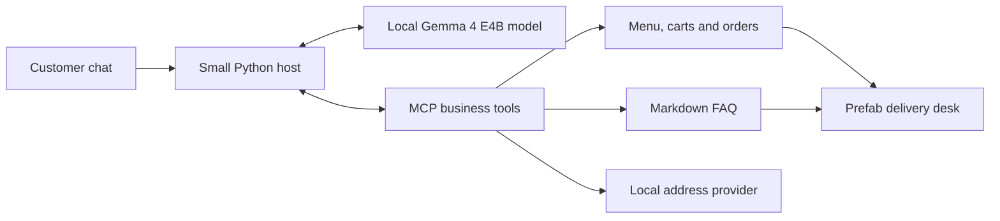
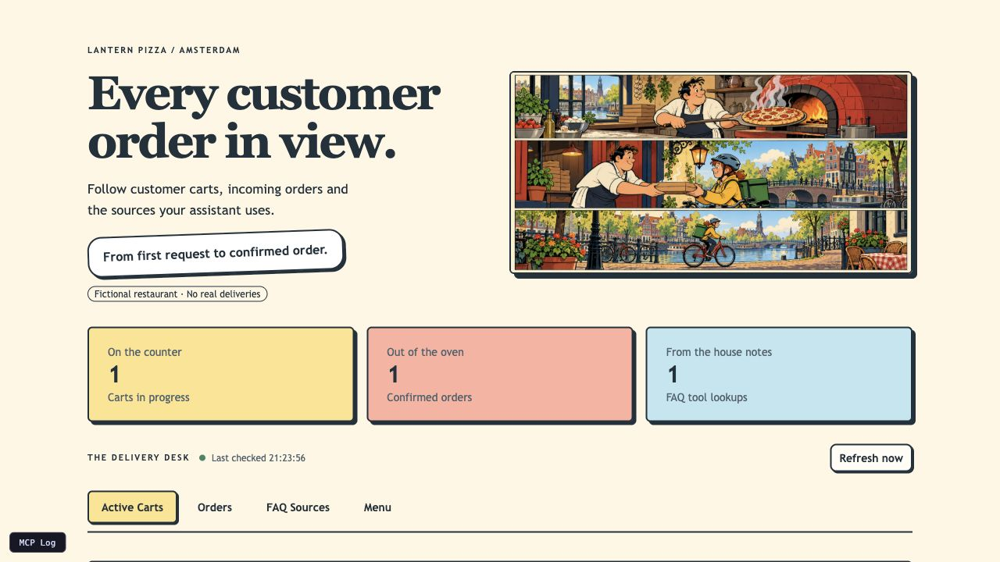
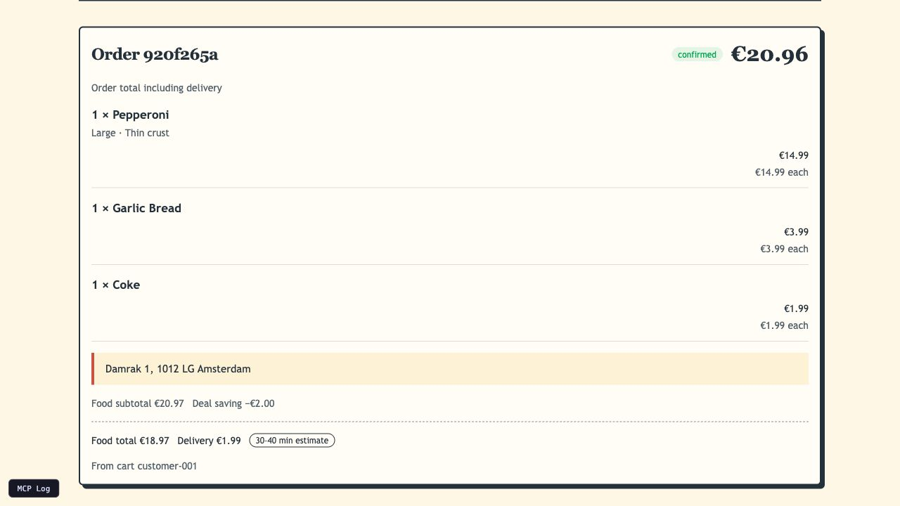
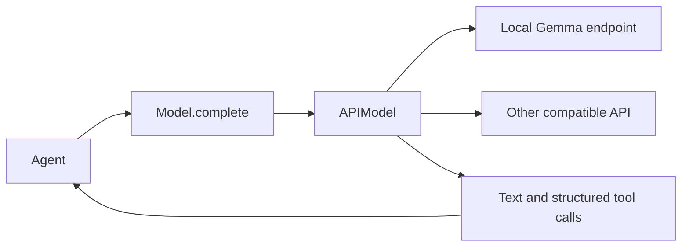

# Chapter 1: build a local AI agent and your own operator UI

A customer asks for pizza, sides and drinks, delivered to their home. Your
assistant turns that conversation into a cart, a delivery address and a confirmed
order. The interesting question is what happened when the assistant says it did.

A successful menu lookup can still be followed by “Our menu includes Sushi Pizza
for €1.00.” We can make that happen with a scripted model reply: the ordering
tools reject invented item IDs, but the host passes the invented answer to the
customer. This demonstrates a gap in the controls; it does not measure how often
a real model makes that mistake.

Keep three things separate as you build: **claims**, the assistant's words;
**actions**, the tools the host actually executes; and **outcomes**, the resulting
business records. Looking at all three makes a useful answer different from a
convincing-looking conversation.

Lantern Pizza is a fictional Amsterdam pizzeria, built from a hackathon project
and reduced to a small foundation for this series. This chapter has three parts,
each with something you can reuse in your own work:

1. **Prefab:** build an operator view in Python, connect it to application state,
   and understand the browser's refresh loop.
2. **MCP and middleware:** expose Python business functions as tools, then observe
   their results at one boundary while keeping their rules in ordinary code.
3. **RapidMLX:** serve a local model and inspect context use, first output,
   request throughput and memory with their measurement boundaries intact.

This walkthrough is for Python users who can follow functions, type hints and
`async` calls. You do not need previous MCP, UI or agent-framework experience.
The primary local-model recipe uses an Apple silicon Mac; Python 3.11+, Git,
Make and uv are required for the application. The examples use **Prefab 0.20.2**,
**FastMCP 4.1.2** and **rapid-mlx 0.16.8**; [uv.lock](uv.lock) records the
application environment. Follow the
[README setup](README.md#start-the-assistant-and-delivery-desk) for the pinned
versions, initial model download and memory requirements. The alternative
endpoint recipe is documented there too, with its verification limits.

After setup, run `make up` and `make chat`, then open <http://localhost:8000>.
The model serves on port 9000; MCP and the delivery desk share port 8000.
Use `make status` to inspect listeners, `make logs` to read their output, and
`make down` when finished. Once dependencies, model weights and the bundled data
are installed, the primary recipe runs offline.

The components fit together like this:



The host owns the loop: it chooses which tools the model may request, executes
them, returns their results and limits the number of steps. The delivery desk
reads the same business state as those tools. Later chapters add tracing,
evaluation and human annotations around this same conversation.

## 1. Build an operator UI in Python with Prefab



Start with a view that helps a person run the service. For Lantern Pizza,
**Active Carts** shows items and missing prerequisites; **Orders** shows confirmed
and cancelled orders; **FAQ Sources** shows recent lookups and opens the source
files; **Menu** displays the actual records. A **Model server** panel reports on
the local serving process. We will unpack those model measurements in part 3.

[Prefab](https://prefab.prefect.io/docs/welcome) builds browser interfaces from
Python components. Nested `with` blocks place one component inside another.
Reactive state and actions describe how that interface changes after it loads.
You can reuse this pattern for a job monitor, a data-quality review screen or a
small internal tool: choose the records an operator needs, project them into a
snapshot, and bind components to that snapshot.

### Compose a view, then connect its state

The desk's data starts in
[get_operator_snapshot](src/agent_observability/pizza/operator/snapshot.py).
It returns a dictionary containing carts, orders, recent FAQ activity and counts.
[pizza_operator](src/agent_observability/pizza/operator/app.py) turns that
snapshot into components. Here is a reduced version of its refresh-and-display
pattern, with the same imports and application data source:

```python
from prefab_ui.actions import Fetch, SetInterval, SetState
from prefab_ui.app import PrefabApp
from prefab_ui.components import Card, Metric
from prefab_ui.rx import RESULT, STATE

from agent_observability.pizza.operator.snapshot import get_operator_snapshot


def pizza_operator() -> PrefabApp:
    refresh = Fetch.get(
        "/desk/snapshot",
        on_success=SetState("snapshot", RESULT),
    )
    with PrefabApp(
        state={"snapshot": get_operator_snapshot()},
        on_mount=SetInterval(duration=3000, on_tick=refresh),
    ) as ui:
        with Card():
            Metric(
                label="Out of the oven",
                value=str(STATE.snapshot.confirmed_order_count),
            )
    return ui
```

This excerpt belongs in the process that owns the business state, alongside the
HTTP route serving `/desk/snapshot`; it is not a separate data store or a
standalone polling server. The complete
[routes](src/agent_observability/pizza/operator/routes.py) provide that endpoint
and serve the generated HTML.

`state` supplies the initial data. In the browser, `SetInterval` runs every three
seconds, `Fetch` requests a fresh snapshot, and `SetState` stores the returned
`RESULT`. `STATE.snapshot.confirmed_order_count` describes a binding to that
browser state. Python constructs the view; the browser executes these actions
and updates the metric. The full app adds **Refresh now** and a warning when
refresh fails, so the operator can recognize stale values.

Follow the snapshot function first, then the view and its
[individual tabs](src/agent_observability/pizza/operator/). Artwork and CSS live
in [resources/prefab/](resources/prefab/). To adapt the example, replace the
snapshot projection and the components displaying it before adding more UI.

The route calls `html(renderer_mode="bundled")` to inline Prefab's renderer.
The resulting desk needs no CDN or external UI host. Prefab can also appear in
an MCP Apps host, but this desk is an ordinary page the operator opens directly.
The model neither sees nor operates it.

### Follow one customer through failure and recovery

Open the delivery desk at <http://localhost:8000> and start an order in the chat.
Ask for a large pepperoni on thin crust, garlic bread and a coke. Ask about the
meal deal, then whether the garlic bread contains dairy.

Before checkout, try changing a quantity or removing an item and inspect whether
the deal still qualifies. Restore the original pizza, garlic bread and coke for
the quoted total below.

Ask to confirm before supplying an address. The tool should refuse and preserve
the cart. Provide `Damrk 1, Amsterdam` and select the matching address when the
host asks. Review the quote and give separate approval to confirm. Delivery adds
€1.99, bringing this meal deal to €20.96. Check the **Orders** tab for the record.



After confirmation, ask to show your orders and cancel the one just
placed; its cancelled record stays in **Orders**. The
[README journey](README.md#follow-a-customers-changing-order) gives the requests
one message at a time.

For your own task, include a missing prerequisite, a correction and a successful
completion. Inspect state after each step. The screenshots here come from a
direct MCP walkthrough; a model conversation may take a different path. A
plausible reply and a correct business record are separate observations.

## 2. Expose and observe Python tools with MCP

[Model Context Protocol](https://modelcontextprotocol.io/docs/learn/architecture)
provides a common way for a client to discover and call tools on a server.
[FastMCP](https://gofastmcp.com/servers/tools) implements that interface for our
Python functions: it uses their names, docstrings and type annotations to describe
what each tool does and what arguments it accepts.

In [pizza/tools/](src/agent_observability/pizza/tools/), ordinary `@mcp.tool()`
functions implement menu, cart, delivery and order actions. Each module groups
related business tools. [pizza/server.py](src/agent_observability/pizza/server.py)
mounts those servers and the FAQ tools, and serves the operator's delivery desk. Their
business checks remain ordinary Python code.

### Discover and call tools without a model

A [FastMCP client](https://gofastmcp.com/clients/tools) can discover and invoke
those functions without involving a model:

```python
import asyncio

from fastmcp import Client


async def inspect_menu():
    async with Client("http://localhost:8000/mcp") as client:
        tools = await client.list_tools()
        print([tool.name for tool in tools])
        result = await client.call_tool("browse_menu", {"category": "pizza"})
        print(result.data)


asyncio.run(inspect_menu())
```

In [client.py](src/agent_observability/client.py), `Agent.prepare` filters the
catalog and converts the MCP input schemas into the model API's tool definitions.
The standard chat keeps the business tool catalog stable across turns and excludes
app-only tools such as address selection. The chat prompt and tool descriptions guide the workflow.
`Agent.send` receives a requested name and arguments, checks the advertised set,
injects the host's session ID where needed, and calls MCP. The model proposes an
action; this host performs the dispatch.

Follow `browse_menu` on the server, then `Agent.prepare` and `Agent.send` on the
client. Reuse this pattern to expose functions you govern through a discoverable
interface while keeping dispatch and business rules under your control.

### What the model sees, and when

**Tool definitions arrive up front; business facts arrive when requested.**
The host discovers the available MCP tools through
[`tools/list`](https://modelcontextprotocol.io/specification/2026-07-28/server/tools#listing-tools),
then [prepares the model's catalog](src/agent_observability/host/catalog.py).
The standard chat exposes all 18 allowed tools, including their descriptions and
full argument schemas, from its first model request. Each regular model request
includes that same catalog; choosing a tool does not unlock another group.

| Information | When it enters the model's context |
|---|---|
| System instructions and 18 tool definitions | From the first request |
| Menu records, cart contents and address candidates | After the corresponding tool call returns |
| Retrieved FAQ filenames, matching lines and document text | As the model calls the discovery, search or read tools |
| Python implementations, app-only tools and the operator's desk | Kept outside the model's context |

For example, the model already knows how to call `faq_find`, `faq_grep` and
`faq_read`. It can discover a filename, inspect a matching line, then read the
document for its table headings. That progressively reveals **source content**;
the three tool definitions were available throughout. This is a possible search
path, not a required sequence: the prompt already names `allergen_info.md`, so
the model can read it directly. Retrieved content stays in the conversation
history for later requests.

<details>
<summary>Optional: instruction skills and larger tool catalogs</summary>

Two extensions address different needs:

- **Reusable instructions:** [Agent Skills](https://agentskills.io/specification#progressive-disclosure)
  reveal metadata, `SKILL.md` instructions and supporting files in stages.
  [FastMCP's Skills Provider](https://gofastmcp.com/servers/providers/skills)
  serves those files as resources; the host still needs to discover and read them.
- **Large tool catalogs:** [FastMCP tool search](https://gofastmcp.com/servers/transforms/tool-search)
  lets the model search for matching tool definitions on demand, adding discovery
  to the workflow.

Chapter 1 uses one working path with a fixed catalog. Later traces can help us
compare alternatives by context usage, response time and successful orders
before introducing another loading mechanism.

</details>

### Describe read-only tools with MCP annotations

`@mcp.tool(annotations={"readOnlyHint": True})` adds metadata for the MCP client.
It describes a lookup or calculation that leaves business state alone, such as
menu browsing, a cart view or a meal-deal quote. Mutation tools, such as adding
items or confirming an order, omit this hint. Its protocol default is false.

Our host reads `tool.annotations.read_only_hint` to distinguish lookups from
mutations: repeated lookups can execute, while identical successful mutations
within one user turn are suppressed. This is our host's policy, not behavior
automatically supplied by the decorator. These annotations stay in MCP metadata;
the model receives tool names, descriptions and argument schemas.

The [MCP specification](https://modelcontextprotocol.io/specification/2026-07-28/schema#toolannotations)
defines annotations as advisory hints. They do not prevent a function from
writing state, establish authorization or validate its answer. The code and
tests must keep the description accurate; viewing an absent cart, for example,
returns an empty view without creating a new business cart.

### Observe calls once with FastMCP middleware

The FAQ feed connects the tools to the UI. Rather than putting recording code in
every FAQ function, [pizza/server.py](src/agent_observability/pizza/server.py)
registers one observer after mounting the tool servers:

```python
mcp.add_middleware(FaqActivityMiddleware())
```

[FastMCP middleware](https://gofastmcp.com/servers/middleware) wraps server
operations. It is a FastMCP facility, rather than a separate MCP protocol feature.
`on_call_tool` receives the tool request and a `call_next` function that continues
the chain. Code before the `await` observes the request; code afterward can
inspect its result. Return that result to preserve the tool's response.

This reduced version of
[FaqActivityMiddleware](src/agent_observability/faq/activity.py) shows the control
flow for `faq_read`. The full implementation handles every `faq_*` tool and
projects filename lists, matching passages and document reads for the desk:

```python
from typing import Any

from fastmcp.server.middleware import CallNext, Middleware, MiddlewareContext

lookups: list[dict[str, Any]] = []


class ReadActivityMiddleware(Middleware):
    async def on_call_tool(
        self, context: MiddlewareContext, call_next: CallNext
    ) -> Any:
        if context.message.name != "faq_read":
            return await call_next(context)
        args = dict(context.message.arguments or {})
        activity: dict[str, Any] = {
            "tool": "faq_read",
            "status": "Lookup failed",
        }
        try:
            result = await call_next(context)
            activity.update(
                status="Document read",
                documents=[{"filename": str(args["filename"])}],
            )
            return result
        finally:
            lookups.append(activity)
            del lookups[:-20]
```

Unrelated tools pass straight through. A document read starts with a failure
status; only a returned result changes that status. If the tool raises, the
exception continues to the client and `finally` still records the failed lookup.
The observer returns successful results unchanged. This keeps reading documents
and projecting activity into two focused pieces of code.

In the actual app, the server retains at most **20 FAQ records** and the snapshot
shows the latest **10**. This is a recent, server-wide activity feed, with no
session, turn or answer identity. Opening a source displays its current file
contents. It is useful for inspecting a walkthrough, but it cannot establish
which exact source text grounded a particular answer. It also cannot see a tool
request suppressed by the host before reaching the server, or the model's final
reply. Chapter 2 will connect those boundaries.

When adapting this hook, decide which requests and outcomes you need to record
and who may see them. Keep the business function responsible for its result;
keep the observer's projection small and explicit.

### Own the loop that turns model output into tool calls

The model returns either text or a request to call a tool. The host checks and
executes the requested action, adds its result to the conversation and asks the
model again. It stops when there is a text answer; when the step limit is
reached, the model gets one final call without tools to wrap up partial
progress. [Agent.send](src/agent_observability/client.py) delegates to the small
[turn loop](src/agent_observability/host/loop.py); execution and dispatch
have their own focused modules.

### Give tools ownership of facts and calculations

Keep prices, eligibility rules and totals in application code. The ordering
tools read the menu and calculate the cart total. A large pepperoni, garlic bread
and coke qualify for a €2 discount because the deal tool checks the required
food categories before applying it.

For questions about ingredients, allergens, opening hours and delivery policy,
the FAQ tools return text from a small [Markdown corpus](knowledge_base/).
The operator can see which document was consulted and compare it with the answer.

For delivery, the lookup searches 8,910 real address records in Amsterdam's
1012 postcode area. A misspelling such as `Damrk 1` can produce the suggestion
`Damrak 1, 1012 LG Amsterdam`. The host asks the customer to select a result or
correct their details. The model cannot turn its own address guess into a saved
selection.

In your project, decide which values must come from records, which rules require
a calculation, and which decisions need direct user input. Each belongs behind
an explicit application boundary.

### Retrieve context directly from a Markdown corpus

The FAQ lives in ordinary Markdown files in [knowledge_base/](knowledge_base/).
You can read, edit and review the same documents the agent consults. Headings,
tables and notes keep related facts together; the tools read the current files
when called, so an edit is available on the next lookup without rebuilding an
index. This chapter uses no embedding model or vector database.

[faq/server.py](src/agent_observability/faq/server.py) gives the model four
operations over that corpus:

| Tool | What it returns | When it helps |
|---|---|---|
| `faq_ls()` | Available Markdown filenames | Discover what the corpus covers |
| `faq_find(pattern)` | Filenames matching a glob | Locate a document such as `allergen*` |
| `faq_grep(query, filename=None)` | Matching lines with filename and line number | Find evidence in one document or across the corpus |
| `faq_read(filename)` | The full Markdown document | Read headings, tables and surrounding qualifications |

This follows the idea of [direct corpus interaction (DCI)](https://arxiv.org/abs/2605.05242):
give an agent operations for exploring source documents and refining its search
after seeing results. Our implementation is a small, bounded application of that
idea. The host exposes these four read-only MCP tools, and file access stays
inside the configured Markdown directory. The research explores a broader
interface with terminal tools and scripts.

**Give a tool only the files it needs.** In the FAQ server, `_allow` resolves a
requested path before checking its directory and extension:

```python
root = _get_kb()
path = (root / filename).resolve()
if not path.is_relative_to(root) or path.suffix != ".md":
    raise ValueError("Choose a Markdown document inside the knowledge base.")
```

This catches `../` paths and symlinks that lead outside the corpus. The operator's
**Open source** action uses the same guard. A read-only hint describes a tool;
this code enforces which files it may read.

For “Does the garlic bread contain milk?”, a useful sequence of tool requests is:

```python
faq_find(pattern="allergen*")
faq_grep(query="garlic bread", filename="allergen_info.md")
faq_read(filename="allergen_info.md")
```

The search finds the garlic-bread row, but the row alone leaves out the column
headings. Reading [allergen_info.md](knowledge_base/allergen_info.md) supplies
the table's `MI` column, the key defining it as milk/dairy, and the kitchen's
cross-contamination notice. Those facts belong in the context used to answer.
The starter prompt names this document for allergen questions, so the assistant
can also read it directly when it already knows which source it needs.

`faq_grep` performs a case-insensitive substring search. It does not rank results
or match synonyms: a query can miss relevant wording, and no match does not
establish that an ingredient is absent. Full-document reads also grow with the
document's size. This is an approachable starting point for a small FAQ; larger
corpora need explicit decisions about search cost and how much text to return.

The **FAQ Sources** tab lets the operator inspect recent searches and open the
original document, subject to the feed limits described above. Later tracing can capture the question, search arguments,
returned evidence and final answer separately. That gives us a foundation for
distinguishing a missed source, missing context and an answer that misrepresents
the retrieved facts.

### Enforce action prerequisites in code

The host executes only advertised tools, injects its own session identity and
suppresses identical successful business calls within a user turn. Separate
model-step and tool-call budgets also stop unproductive loops and oversized batches. A model-supplied session ID cannot
redirect an action to another customer's cart. Address selection is a host-only
tool invoked after the customer's choice.

The order tool requires items and a saved address selection. A new lookup clears
the old selection, so changed details cannot silently retain an earlier delivery
destination. Cart edits use stable line IDs and recheck deal eligibility. Cancelled
orders remain in history, and the cancellation tool rejects another session's order.
These checks still run when the model proposes an invalid action.

Define the condition precisely before enforcing it. A valid postcode does not
establish that a street address exists. This example instead requires a customer
selection from actual lookup results. Observability can reveal that a check ran;
it cannot make an insufficient check satisfy your business requirement.

Approval has a different status in this demo: the prompt tells the model to wait
for separate customer approval, but the order tool does not enforce that approval.
If your agent performs a consequential action, record and check the authorization
in application code too.

### Offer a meal deal without inventing the pitch

The [starter prompt](src/agent_observability/pizza/prompt.py) distinguishes a
question about offers from an order and requires the customer's choices before
adding a side or drink. The read-only
[`get_meal_deal_offer`](src/agent_observability/pizza/tools/offers.py) tool supplies
eligibility, missing choices and a priced example. It never adds items or applies
the discount.

For a large pepperoni, adding coleslaw and water costs €1.48 more after the €2
bundle saving. That saving compares the same bundle without the deal; it does
not make the customer's original pizza cheaper. The model can phrase the offer
naturally, but the prices come from the tool. The cheapest example is an
illustration, not a choice made for the customer. Ask for their side and drink,
pass their item IDs to the same quote tool, and add them only after agreement.
The tool labels incomplete choices as `example` and complete choices as `selected`.
When the existing cart qualifies and the customer requests the deal, apply the
saving once without asking the customer to buy more.
Keep the offer out of address collection, checkout and cancellation, and do not
pitch again after a decline or item removal.

Use the operator view to check that asking about an offer leaves the cart alone.
These price and state contracts have offline tests. Whether a model offers at
the right moment, respects a decline and describes the saving accurately belongs
in later conversation evaluations; chapter one supplies the use case and evidence.

### Validate the answer, even when the tool call succeeds

A successful lookup proves that data was retrieved. You still need to check
whether the answer delivered to the customer preserves those facts.

`browse_menu` returns the actual menu records. The prompt says to browse before
recommending items and never invent items or prices. The host nevertheless accepts
a menu answer without requiring a lookup, and forwards the model's final text
without checking it against the records.

To expose this gap in your own host, script a valid lookup followed by a wrong
answer. We tried a `browse_menu` call followed by “Our menu includes Sushi Pizza
for €1.00.” The host returned the invented item, both with and without the lookup.
This checks what the host permits; it does not measure the model's error rate.

The ordering tools reject unknown item IDs and calculate cart prices from menu
data. Those protections prevent the invented item from entering the cart, but
leave the customer vulnerable to a misleading description. The operator's
**Menu** tab avoids this step by displaying the records directly.

When an exact listing matters, format names, descriptions and prices directly
from the tool result and report lookup failures explicitly. This chapter's chat
does not yet enforce that approach. Requiring retrieval alone would still leave
the model free to change the retrieved facts in its answer.

When you add observability, evaluate retrieval success and answer accuracy
separately. A log showing `browse_menu` succeeded cannot prove that the customer
received the correct menu.

### Keep your lookup contract separate from its data source

The [address utility](src/agent_observability/utilities/addresses/) implements a small
`AddressLookup` interface and owns snapshot loading and rebuilding. You can replace
the local snapshot with a maintained service while retaining the ordering rule:
an order needs an address the customer selected from lookup results.

A match in this demo means an address appears in a dated snapshot. It does not
guarantee current coverage or that a courier can deliver there. For your project,
define how fresh the data must be, what happens during an outage, and how users
can correct a missing result. Keep those requirements visible when choosing or
replacing the provider. The [data source and rebuild command](resources/addresses/README.md)
show where this snapshot came from.

This prototype uses fictional prices, stores state in memory and performs no
payment or fulfillment. A production order flow also needs authentication,
enforced approval and durable records. Treat those as explicit implementation
requirements when extending the demo.

## 3. Serve and measure a local model with RapidMLX

[rapid-mlx](https://github.com/raullenchai/Rapid-MLX#installation) runs
inference on Apple silicon and exposes an OpenAI-compatible HTTP API. This chapter pins the serving tool to **rapid-mlx 0.16.8** and uses the
`gemma-4-e4b-4bit` alias. The application dependencies are locked separately in
[uv.lock](uv.lock). Keeping the runtime and model explicit makes a result easier
to reproduce. Follow the README to install the pinned tool; the
[Makefile](Makefile) starts it as a separate process:

```bash
rapid-mlx serve gemma-4-e4b-4bit --port 9000
```

### Separate serving from the application

That process loads the model weights and answers requests. Our Python chat
connects to it with the OpenAI client library. In
[APIModel.__init__](src/agent_observability/model.py), the configured values
produce this client:

```python
from openai import AsyncOpenAI

client = AsyncOpenAI(
    base_url="http://localhost:9000/v1",
    api_key="not-needed",
)
```

`base_url` sends the request to the local server. `APIModel.complete` makes
one `chat.completions.create` call with the conversation and tool definitions,
then returns a `Reply`. The small [stream reader](src/agent_observability/llm/streaming.py)
assembles text and tool-argument fragments. Text
reaches the terminal incrementally; tools wait for a complete reply. See the
[streaming function-call contract](https://developers.openai.com/api/docs/guides/function-calling#streaming).
The host's `Agent.send` decides whether another model call is needed.

Read [config.py](src/agent_observability/config.py) for the endpoint and model
settings, then [model.py](src/agent_observability/model.py) for the request and
response conversion. You can reuse this split between model serving and the
application's tool loop. The first local start may download weights; another
compatible endpoint can be selected through the settings.

### Watch the local model work

The terminal prints one `llm>` line after each completed model request. A turn
may make several requests as it calls tools and reads their results. We have two views:
the terminal measures an individual API request from the client, while the desk
polls a snapshot reported by the serving process. Keep them separate when
interpreting a slowdown.

#### Read the terminal measurements

- **Context** is the provider's reported prompt-token count: the system prompt,
  tool definitions and whole conversation, re-sent with every request. Watch it
  grow turn by turn; it is what fills the model's context window.
- **TTFT** is measured with a monotonic clock from request start to the first
  nonempty text, reasoning or tool-call delta received by the client. Empty role
  frames do not count. It includes queueing, prompt processing, transport and
  server buffering; it is a client observation, not the engine's exact first-token
  timestamp. With streaming disabled it is unavailable.
- **Output tokens/s (request)** divides the provider's reported completion-token
  count by the entire request duration, including the initial wait. It is an
  effective request rate, not decode-only throughput. One stream chunk can carry
  several tokens; counting chunks would produce a misleading result. If the
  provider omits usage, the rate stays unavailable.
- **MLX peak GB** comes from the local rapid-mlx `/v1/status` endpoint's
  `metal.peak_memory_gb`. In rapid-mlx 0.16.8, the server preserves a cumulative
  MLX allocator high-water mark across its internal sampling resets. It includes
  model weights and other work in that process, and is not per-request memory or
  total system RAM. The chat reads this shared counter and never resets it.

Timing and token counting live in [metrics.py](src/agent_observability/llm/metrics.py);
the optional local-server lookup lives in [memory.py](src/agent_observability/llm/memory.py).
We read memory after stopping the request clock, with a short timeout. Remote
providers are not probed, and unsupported local servers simply show `n/a`.
Calling MLX from the chat process would measure the wrong process. See the
[MLX memory API](https://ml-explore.github.io/mlx/build/html/python/_autosummary/mlx.core.get_peak_memory.html)
for the counter's scope.

The lifecycle in [APIModel.complete](src/agent_observability/model.py) is:
start `RequestTimer`, issue the HTTP request, observe streamed deltas and usage,
finish assembling the reply, then stop the timer. Only afterward does it read the
optional memory status and notify the terminal. That status lookup has a
short HTTP timeout of 0.5 seconds per network phase. That lookup is excluded
from the reported request duration; it still happens before control returns to
the host.

The rate calculation itself is deliberately small:

```python
# From Measurements.tokens_per_second; units are tokens / seconds.
return self.output_tokens / self.elapsed_s
```

It is evaluated only when the provider supplied a token count and elapsed time
is positive. For example, 100 reported output tokens over a 5-second request
means 20 output tokens/s **over that request**, even if generation after the
initial wait was much faster. These illustrative numbers are not a benchmark.
Do not subtract TTFT and label the result engine throughput: the first observed
delta can contain multiple tokens, and client receipt is not an engine timestamp.

TTFT here means **first streamed output**, which may be a tool-call fragment or
reasoning rather than text visible to the customer. A turn can need several such
requests. A fast first tool call does not imply that the customer received an
answer quickly, and the `llm>` line does not include the later tool execution or
an address-choice wait. Those require turn-level timing.

#### Read the serving process separately

The desk's [Model server projection](src/agent_observability/pizza/operator/model_server.py)
reads `/v1/status` and displays `generation_tps`, `prompt_tps`,
`total_requests_processed` and the same MLX peak-memory field. Prompt processing
is the stage that consumes the input context; generation produces output. The
server reports their rates from its scheduler. They use different boundaries
from the client's whole-request rate.

These are server-wide snapshots, not a per-conversation history. Concurrent
requests can contribute to the rates, and a displayed rate can retain a recent
value while the server is idle. The request counter counts processed model
requests, not customer turns or successful orders. One conversation can make
many model requests without ever placing an order.

Read the model-server panel alongside the terminal and business records. If
context grows and first output slows, inspect the repeated messages and tool
schemas before blaming generation speed. If requests continue but the cart does
not change, inspect the tool path and the customer question. These are leads for
investigation; this chapter has no trace record that proves the cause.

#### Compare runs with their conditions attached

For a useful comparison, record the model and quantization, rapid-mlx version,
hardware and available memory, prompt and tool catalog, sampling settings, and
whether the request is cold or warm. This adapter requests temperature **0.2**
and at most **1,024 output tokens**. Keep the customer journey fixed, repeat it,
and inspect rejections, correct totals and completed orders alongside timing.
Changing the model or serving settings can change both tool behavior and speed.

The first start may download weights, and memory pressure from other processes
can make an otherwise valid setup unusable. The README explains startup timeout
and memory-cap options. No measured model comparison or reliability claim is
made here; a completed walkthrough is a smoke check. The client measurements
and the server panel establish the quantities we can investigate with traces
in Chapter 2.

### Swap the model at one boundary

The agent needs a model reply, not knowledge of how that reply was generated.
[llm/contracts.py](src/agent_observability/llm/contracts.py) defines that boundary with a small
Python protocol:

```python
class Model(Protocol):
    async def complete(
        self,
        messages: list[dict[str, Any]],
        tools: list[dict[str, Any]],
        *,
        on_text: TextCallback | None = None,
    ) -> Reply: ...
```

`Reply` contains text and structured `ToolCall` records: an ID, a name and
decoded arguments. `Agent` receives any object implementing this method and
decides what to do with the reply. The adapter makes one inference request;
the agent owns the loop around requests and tool results.

A protocol is checked by shape, not inheritance: `APIModel` never subclasses
`Model`, and the tests drive the agent with a scripted class that has the same
method. One call from messages and tools to a reply is often all an agent needs;
[LiteLLM's `completion()`](https://docs.litellm.ai/docs/completion) puts many
providers behind an OpenAI-compatible interface. That is a useful next step when
your project needs more provider adapters: wrap its response in this chapter's
`Reply` contract, including tool calls and streaming behavior. LiteLLM is a linked
extension here; the starter runs directly against the configured endpoint.



For another OpenAI-compatible model, configure `llm_base_url`, `llm_model` and
`llm_api_key`. `chat.py` passes them to `APIModel`; the environment variables in
the [README](README.md#swap-the-model-keep-the-agent) show how. The key is a
`SecretStr` setting, so displaying settings masks its value. Local servers use
the placeholder `not-needed`. The model's name does not enter the business tools.

If a provider uses a different API, implement this same `complete` method and
translate its response into `Reply` and `ToolCall`. Keep provider credentials,
stream assembly and response parsing in that adapter. Only complete, validated
tool requests reach the host; incomplete responses raise `ModelError`.
The scripted models in the tests implement the same interface without a server.

This separates changing a model from changing business authority. Swapping an
endpoint does not change which tools the host may execute or what an order tool
requires. It can change behavior: tool-call support, schema handling, streaming
and conversational quality need to be checked for each model. The local and
authenticated endpoint contracts have offline wire tests; no hosted provider
is called by the starter recipe or its tests.

## Carry the evidence into Chapter 2

You now have three reusable pieces: a Python view over application state, MCP
tools observed through middleware, and a local inference client with explicit
measurement boundaries. The business tools decide whether an action may commit;
the UI and measurements help inspect what happened.

### Test the host's rules independently of model behavior

The offline tests exercise real MCP tools and the real address snapshot, while
scripted model replies make host behavior repeatable. They cover rejected orders,
deals, customer selection, changed addresses, lookup failures and session boundaries.
Run them with `make verify`; inspect the [host tests](tests/test_client.py) and
[tool tests](tests/test_tools.py) when adapting the example.

Use scripted replies to deliberately request an unknown tool, omit a required
step or repeat a call. Then check the tool result and resulting state. These tests
tell you whether your host enforces its rules. Separate live conversations are
needed to assess how reliably a chosen model completes the task.

With those checks in place, the next chapter can add tracing around concrete
requests, results and state changes, and investigate where a conversation failed.
It will extend this Amsterdam workflow, including customer address selection,
cart corrections and cancellation. The custom UI gives us a place to surface
that evidence; later chapters will extend it for trace debugging and human
annotations.
