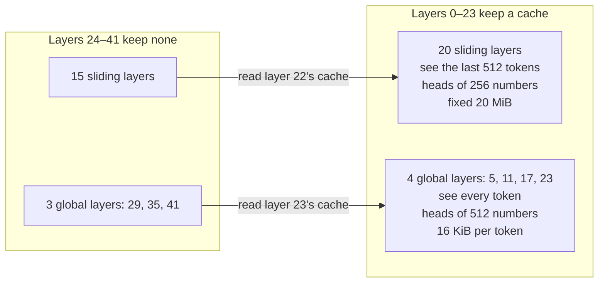

# Deep-dish: why a "4B" model needs 5 GB

You want an agent that runs on your own laptop, so you pick a small model.
Gemma 4 E4B: 4B parameters (weights), each stored in 4 bits. Four billion
half-bytes is 2 GB, so it should fit beside your editor and your browser with
room to spare.

We expected that for the pizza agent in [Chapter 1](../article.md). The model
server held 5.15 GB before it read a word, and the longer the prompt, the
slower the reply. For an agent both hurt: memory decides what else fits on
your laptop, and the prompt only grows, because every turn sends the whole
chat again.

The model stores 7.5B parameters, and two rules explain most numbers on this
page:

- **Memory follows what the model stores.**
- **Speed follows what each token reads.**

A third pattern we read in rapid-mlx's code and did not measure: layers that
reuse an earlier layer's memory save space but still spend the time to read
it.

You get where the memory goes, four settings that trim it, and a way to
estimate speed.

**The setup.** An M5 Pro with 24 GiB (24 × 1,024³ bytes), the model server
rapid-mlx 1.0.1 on Apple's MLX 0.32.4, the model file (checkpoint)
`mlx-community/gemma-4-e4b-it-4bit`, prompts of up to 28K tokens at
temperature 0 (no randomness), every test run three times unless marked
otherwise. Memory comes from the server's `GET /v1/status`: `active_memory_gb`
at rest, and `peak_memory_gb`, the MLX peak in Chapter 1's
[Measure](../article.md#3-measure-one-line-for-each-model-request) line.
Memory was identical in every run. Rerun the tests with
[e4b_measure.py](e4b_measure.py) (`--tokens 3500` for the 3.5K rows).

**Words you will meet.**

- **Token**: a word or piece of a word; models read and write in tokens.
- **Prefill**: the model reads your prompt, in chunks. It sets the time to the
  first token.
- **Decode**: the model writes its reply, one token at a time.
- **KiB, MiB, GiB**: steps of 1,024 bytes; GB is a billion bytes.
- **KV cache**: what the model keeps for each token it has read: a key and a
  value, two lists of numbers per layer. It grows with the prompt.
- **Embedding table**: one row of numbers for each word in the vocabulary.

## Where the 7.5B comes from

The model file's index of contents lists every block of weights and its size:

| Part | Parameters | Bytes at 4.5 bits |
|---|---|---|
| Per-layer embedding (PLE) table | 2.82 B | 1.59 GB |
| Token embedding | 0.67 B | 0.38 GB |
| The 42 layers' own weights | 3.97 B | 2.24 GB |
| **Text model** (rows rounded) | **7.46 B** | **4.20 GB** |

The PLE table gives each of the 42 layers a small extra input for every word
in the vocabulary. The "E" in E4B is for *effective*: for each token, the
model runs the 4B core (the 3.97 B row) and takes one row from the PLE table
and one from the token embedding. But the next token can need any row, so
every row stays in memory.

"4-bit" is really 4.5 bits. Each group of 64 weights also keeps a 16-bit scale
and offset to map its 16 levels back to real numbers: (64 × 4 + 32) ÷ 64 = 4.5
bits per weight. Smaller groups round more accurately and cost more bits:

| Group size | Bits per weight | This model's text weights |
|---|---|---|
| 128 | 4.25 | 3.96 GB (would be) |
| **64 (this checkpoint)** | **4.5** | **4.20 GB** |
| 32 | 5.0 | 4.66 GB (would be) |

## Memory: one flag, then a small cache

At rest the server held 5.15 GB. The checkpoint also carries a vision encoder
and an audio encoder, 0.95 GB in all. When `mlx-vlm` is installed, as it was
for us, rapid-mlx serves the model on its multimodal path (text plus images
and audio) and loads them. A text agent needs neither:

```bash
make model MLX_ARGS="--text-only"
```

Memory at rest fell to 4.20 GB, the text weights alone, and speed held:

| Path | At rest | First token, 28K | Decode, 28K |
|---|---|---|---|
| multimodal (what we got) | 5.15 GB | 13.8 to 14.2 s | 33.6 to 34.1 tok/s |
| `--text-only` | 4.20 GB | 13.8 to 14.6 s | 33.2 to 34.6 tok/s |

Next, the KV cache. The model's
[config.json](https://huggingface.co/mlx-community/gemma-4-e4b-it-4bit/blob/475b9088d29754a3379866cf5aeb6b41acd313c2/config.json)
sets 42 layers in a pattern, 5 *sliding* layers that see the last 512 tokens,
then 1 *global* layer that sees every token, seven times. Each layer splits
its work into parallel *heads*, and global layers use wider ones. From this it
predicts 16 KiB per token. On the multimodal path, MLX keeps a request's freed
buffers for reuse and reports them as `cache_memory_gb`: 0.02 GB at rest, then
0.08, 0.26 and 0.49 GB after 3.5K, 14K and 28K tokens (the first two one run
each). This indirect reading climbs about 16 KiB per token. Counting all 42
layers alike, at 256 numbers per head, would give 84 KiB. The diagram shows
why:



- The 20 sliding caches stop growing at 20 layers × 2 heads × 256 × 2 (key and
  value) × 2 bytes (16-bit numbers) × 512 tokens = 20 MiB.
- The 4 global caches grow by 4 × 2 × 512 × 2 × 2 bytes = 16 KiB per token.
- In rapid-mlx's [Gemma 4
  code](https://github.com/raullenchai/Rapid-MLX/blob/v1.0.1/rapid_mlx/models/gemma4_vendored/language.py),
  a layer that borrows reads the last earlier cache of its kind, in full, at
  every token.

So `--kv-cache-dtype int8`, which halves the 4 global caches by storing 8-bit
numbers and spends time unpacking them, has little to save: at 28K tokens it
lowered the peak by 0.11 GB, half what halving predicts, and slowed decode by
about 9% (31.0 to 31.5 against 33.2 to 34.6 tokens per second). It should
start to pay near the model's 128K-token limit, where the cache would reach
about 2 GiB.

## Speed: each token is a read

To write each token, the GPU streams every weight it needs from memory and
mostly waits for the bytes. How fast it can stream is the memory bandwidth:

> tokens per second ≈ memory bandwidth ÷ bytes read per token

The usual shortcut reads the whole model for each token. E4B reads 1.59 GB
less: the PLE table costs memory and almost no bandwidth, because a token
reads one row of it, about 6 KB. The output step scores every word in the
vocabulary, so it rereads the whole token embedding, so each token reads about
2.6 GB.

We compared a second model of the same shape: NVIDIA's Nemotron 3.5 Bolt E4B
at 8 bits, in groups of 64 per its
[config.json](https://huggingface.co/rapid-mlx/NVIDIA-Nemotron-3.5-Bolt-E4B-MLX-8bit/blob/72263b814727693c874bf765c657dfb32102e870/config.json),
so 8.5 bits. It has the same 7.46 B weights and held 7.93 GB at rest, which is
7.46 B × 8.5 bits. It reads about 4.9 GB per token.

Text path, prefix cache off, so no reuse of earlier prompts (`--text-only
--disable-prefix-cache`):

| Prompt tokens | Gemma, 4-bit | Nemotron, 8-bit |
|---|---|---|
| 3.5K | (not run on this path) | 30.8 to 32.2 tok/s |
| 7K | 34.7 to 43.9 tok/s (one slow run) | (not run) |
| 14K | 38.1 to 38.9 tok/s | 27.0 to 27.2 tok/s |
| 28K | 33.2 to 34.6 tok/s | 24.0 to 24.8 tok/s |

At 14K and 28K, Nemotron reads 1.9 times the bytes and is only 1.4 times
slower. So part of each token's time does not depend on bytes read. Decode
also slows from 14K to 28K, which fits each token reading a bigger cache.
Implied bandwidth on this Mac at 28K: about 89 GB/s for Gemma and 119 GB/s for
Nemotron (100 and 134 at 14K), so treat the formula as a rough guide.

## Prefill: the peak of a long prompt

At 28K tokens the peak rose 2.08 GB above rest. The KV cache should be about
0.48 GB; the other 1.6 GB is working memory for reading the prompt in chunks,
and it grows with the chunk size. On the text path, rapid-mlx's
[default](https://github.com/raullenchai/Rapid-MLX/blob/v1.0.1/rapid_mlx/cli_parser.py)
chunk is 2,048 tokens:

| `--prefill-step-size` | Peak above rest, 28K | First token, 28K |
|---|---|---|
| 256 | 1.09 GB | 14.9 to 15.6 s |
| 512 | 1.52 GB | 14.2 to 15.0 s |
| 2,048 (default) | 2.08 GB | 13.8 to 14.6 s |
| 8,192 | 3.04 GB | 16.7 to 17.1 s |

512 saved 0.56 GB and was at most 0.5 s slower, too small to call.

## Prefix cache: the agent's best friend

The prefix cache, on by default, keeps earlier requests' caches, so the server
reads only new tokens. In a 4-turn chat that opens with a 7K-token message:

| Turn | First token, cache off | First token, cache on |
|---|---|---|
| 1 | 3.1 to 3.8 s (one slow run) | 3.1 to 3.2 s |
| 2 to 4 | 3.1 to 3.8 s (one slow run) | 0.19 to 0.21 s |

It costs memory: 0.3 GB per turn here, because the log shows two entries per
request, which fits two copies of its cache, capped at 4 GB on this Mac. It
also writes the cache to disk when the server stops (one run wrote 1.1 GB)
and, per the code, loads it at the next start. [Next to the
cache](https://github.com/raullenchai/Rapid-MLX/blob/v1.0.1/rapid_mlx/memory_cache.py)
it saves each chat's tokens, which turn straight back into the text. If other
people use the machine, or it serves real customers, add
`--disable-disk-caches`.

## Take these home

- **Read the size from the file** or the server's memory at rest. "4-bit" is
  4.5 bits.
- **Check which path your server picked.** `--text-only` freed 0.95 GB.
- **Count the KV cache by layer type.** Counting every layer the same would be
  five times too high.
- **Estimate decode from bytes read per token,** as a rough guide.
- **Try a smaller prefill chunk.** 512 trimmed the peak by 0.56 GB.
- **Keep the prefix cache on for an agent,** and its disk copy off wherever
  real chats pass through.
- **Run everything three times.** A gap smaller than the spread is noise.

Expect the same pattern on your Mac, with different values.
